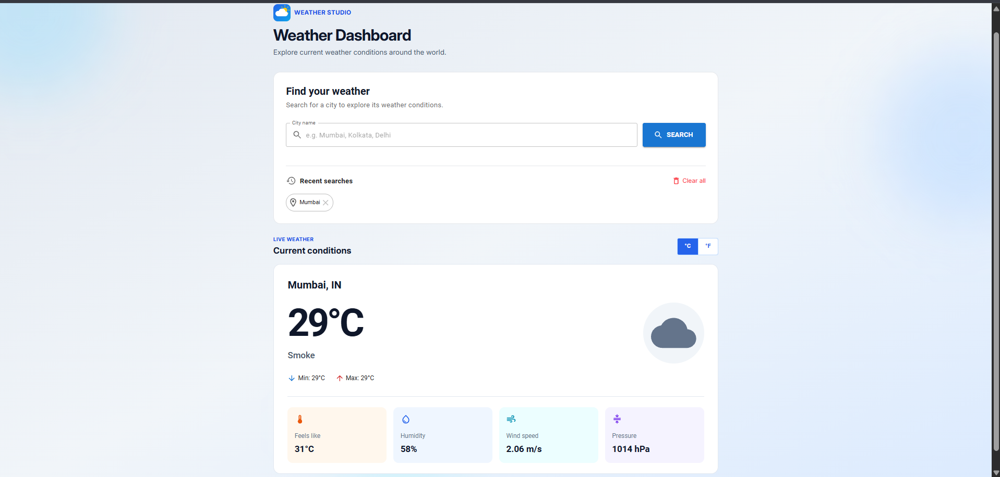

# 🌤️ Weather Studio — Weather Dashboard

A responsive weather dashboard built with **React, TypeScript, Vite, Material UI, and Tailwind CSS**. Search for a city and explore its current weather conditions through a clean, intuitive interface.

<p align="center">
  
</p>

<p align="center">
  <strong>Real-time weather information. Simple, clear, and responsive.</strong>
</p>

---

## 🌐 Live Demo

<p align="center">
  <a href="YOUR_VERCEL_DEPLOYMENT_URL">
    <strong>🚀 View Weather Studio Live</strong>
  </a>
</p>

---

## ✨ Features

- 🔍 **City Search** — Search for weather conditions by city name.
- 🌡️ **Temperature Display** — View current, minimum, maximum, and feels-like temperatures.
- 🔄 **Temperature Conversion** — Switch between Celsius (°C) and Fahrenheit (°F).
- 💧 **Humidity** — View current humidity percentage.
- 💨 **Wind Speed** — Check current wind speed.
- 🌬️ **Atmospheric Pressure** — View atmospheric pressure in hPa.
- 🌦️ **Dynamic Weather Icons** — Weather icons change according to current conditions.
- ❄️ **Weather-Based Backgrounds** — Background appearance changes according to weather conditions, including snow and frost.
- 🕘 **Recent Searches** — Access previously searched cities.
- 💾 **Local Storage** — Preserve recent searches and the last displayed weather after refreshing the page.
- ⚠️ **Error Handling** — Display useful messages for invalid cities, API errors, and network failures.
- ⏳ **Loading States** — Show feedback while retrieving weather data.
- 📱 **Responsive Interface** — Designed for desktop, tablet, and mobile screens.

## 🛠️ Tech Stack

| Technology            | Purpose                           |
| --------------------- | --------------------------------- |
| React 19              | UI development                    |
| TypeScript            | Type safety                       |
| Vite                  | Development server and build tool |
| Material UI           | UI components                     |
| Material UI Icons     | Weather and interface icons       |
| Tailwind CSS v4       | Styling and responsive layouts    |
| Emotion               | Material UI styling engine        |
| OpenWeatherMap API    | Weather data                      |
| Browser Local Storage | Persistent application data       |
| Google Fonts — Inter  | Typography                        |

## 📸 Application Preview



## 🚀 Getting Started

Follow these steps to run the project locally.

### Prerequisites

Make sure you have installed:

- [Node.js](https://nodejs.org/)
- npm
- An [OpenWeatherMap API key](https://openweathermap.org/api)

### 1. Clone the repository

```bash
git clone https://github.com/Mourya973/Weather.git
```

### 2. Navigate to the project

```bash
cd Weather
```

### 3. Install dependencies

```bash
npm install
```

### 4. Configure environment variables

Create a `.env` file in the root directory:

```env
VITE_OPENWEATHER_API_KEY=your_openweathermap_api_key
```

Replace `your_openweathermap_api_key` with your actual API key.

**Important:** Never commit your actual `.env` file to GitHub. Keep it in `.gitignore`.

### 5. Start the development server

```bash
npm run dev
```

Open the local URL displayed in your terminal. Vite typically uses:

```text
http://localhost:5173
```

## 📦 Available Scripts

| Command           | Description                                     |
| ----------------- | ----------------------------------------------- |
| `npm run dev`     | Start the development server                    |
| `npm run build`   | Type-check and build the production application |
| `npm run lint`    | Run ESLint                                      |
| `npm run preview` | Preview the production build locally            |

## 📁 Project Structure

```text
Weather/
│
├── public/
│   └── favicon.svg
│
├── screenshot/
│   └── weather-dashboard.png
│
├── src/
│   ├── components/
│   │   ├── AppButton.tsx
│   │   ├── SearchBox.tsx
│   │   └── InfoBox.tsx
│   │
│   ├── services/
│   │   └── weatherService.ts
│   │
│   ├── types/
│   │   └── weather.ts
│   │
│   ├── App.tsx
│   ├── main.tsx
│   └── index.css
│
├── .env
├── .gitignore
├── index.html
├── package.json
├── tsconfig.json
├── vite.config.ts
└── README.md
```

## 🌐 API Integration

This project uses the [OpenWeatherMap API](https://openweathermap.org/api) to retrieve weather information.

Weather information displayed includes:

- City and country
- Current temperature
- Feels-like temperature
- Minimum and maximum temperature
- Weather description and condition icon
- Humidity
- Wind speed
- Atmospheric pressure

## 💾 Data Persistence

The application uses browser `localStorage` to preserve selected application data.

- Recent city searches are saved for later access.
- The last successfully retrieved weather information is restored after a browser refresh.
- The last updated timestamp is preserved with the saved weather data.

## 🧠 React Concepts Practiced

- Functional components
- React Hooks: `useState`, `useEffect`, `useCallback`, and `useRef`
- Props and component communication
- Controlled forms and event handling
- State lifting and callback functions
- Conditional rendering
- Asynchronous API requests using `async/await`
- Error handling
- Browser Local Storage

## 🔐 API Key Security

This project uses a Vite environment variable prefixed with `VITE_` to access the OpenWeatherMap API key.

**Note:** Vite exposes `VITE_` variables in the client-side application bundle. This is suitable for a learning project, but it does not provide true API-key secrecy. Restrict the key through your provider's available controls and use a backend proxy for production applications requiring stronger protection.

## 👨‍💻 Author

**Mourya Mouli Manna**

- GitHub: [@Mourya973](https://github.com/Mourya973)
- Project Repository: [Weather Dashboard](https://github.com/Mourya973/Weather)

---

<p align="center">
  Built with React, TypeScript, and OpenWeatherMap.
</p>
